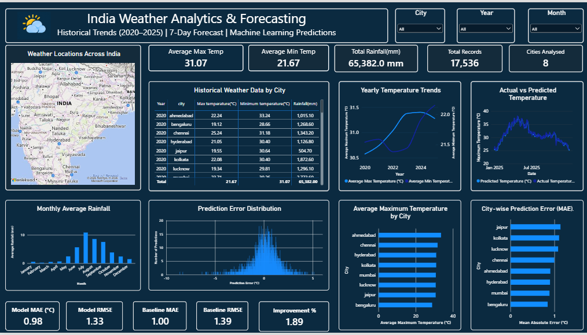

# India Weather Analytics & Forecasting

## About the Project

I built this project to analyze weather patterns across eight Indian cities using Python, PostgreSQL, Power BI, and Machine Learning.

I worked with historical weather data from 2020 to 2025, analyzed temperature and rainfall patterns, created an interactive Power BI dashboard, and built a Random Forest model to predict daily maximum temperatures. I also used the Open-Meteo API to collect seven-day weather forecasts.

Through this project, I wanted to understand how raw weather data can be converted into useful insights using data analytics and visualization.

## Tools I Used

- Python
- PostgreSQL
- Power BI
- Pandas and NumPy
- Scikit-learn
- Open-Meteo API
- Google Colab

## Cities Covered

I analyzed weather data for eight Indian cities:

Ahmedabad, Bengaluru, Chennai, Hyderabad, Jaipur, Kolkata, Lucknow, and Mumbai.

## What I Worked On

- Collected and analyzed historical weather data from 2020 to 2025.
- Stored the data in PostgreSQL and used SQL queries to analyze weather patterns.
- Compared average maximum and minimum temperatures across cities.
- Analyzed yearly temperature trends and monthly rainfall patterns.
- Identified the hottest recorded day in each city.
- Checked the dataset for missing values and data quality issues.
- Created an interactive Power BI dashboard with KPIs, charts, a map, and filters.
- Collected seven-day weather forecasts using the Open-Meteo API.
- Built a Random Forest regression model to predict daily maximum temperatures.
- Compared the model's performance with a simple baseline prediction.

## Dashboard Preview

My Power BI dashboard includes:

- Average maximum and minimum temperature
- Total rainfall and total weather records
- Weather locations across India
- Historical weather data by city and year
- Yearly temperature trends
- Monthly average rainfall
- Actual versus predicted temperatures
- Prediction error distribution
- City-wise average temperature
- City-wise model error (MAE)

The dashboard also includes city, year, and month filters to explore the data.

## Key Findings

After analyzing the historical weather data, I found that:

- Ahmedabad had the highest average maximum temperature, at approximately **33.6°C**.
- Bengaluru had the lowest average minimum temperature, at approximately **18.9°C**.
- Mumbai recorded the highest total rainfall during the 2020–2025 period, at approximately **14,945.7 mm**.
- Jaipur recorded the lowest total rainfall among the eight cities, at approximately **4,005.8 mm**.

These comparisons helped me understand the differences in temperature and rainfall patterns across the selected cities.

## SQL Analysis

I used PostgreSQL to organize and analyze the weather data.

Some of the queries I worked on included:

- Checking total records and missing values.
- Calculating average temperatures by city and year.
- Comparing monthly temperature and rainfall patterns.
- Finding the hottest recorded day in each city.
- Calculating forecast temperature and rainfall summaries.
- Grouping and sorting data to compare weather conditions across cities.

I used SQL functions and concepts such as `GROUP BY`, `ORDER BY`, `AVG()`, `SUM()`, `COUNT()`, `ROUND()`, `EXTRACT()`, `ROW_NUMBER()`, and `DISTINCT ON`.

## Dataset Details

### Historical Weather Data

The historical dataset contains **17,536 records** from eight Indian cities, covering 2020–2025.

| Column Name | Description |
|---|---|
| `time` | Date of observation |
| `temperature_2m_mean` | Average temperature (°C) |
| `temperature_2m_max` | Maximum temperature (°C) |
| `temperature_2m_min` | Minimum temperature (°C) |
| `wind_speed_10m_max` | Maximum wind speed |
| `precipitation_sum` | Total precipitation |
| `rain_sum` | Total rainfall |
| `weather_code` | Weather condition code |
| `city` | City name |

### Seven-Day Forecast Data

I also collected forecast data for the same eight cities using Open-Meteo.

| Column Name | Description |
|---|---|
| `city` | City name |
| `date` | Forecast date |
| `max_temp` | Forecast maximum temperature |
| `min_temp` | Forecast minimum temperature |
| `rain` | Forecast rainfall |

This dataset contains **56 records**, representing seven forecast days for each city.

## Machine Learning

I built a Random Forest regression model to predict daily maximum temperatures using historical weather information.

I trained the model using data from 2020–2024 and evaluated it on test data from 2025.

### Model Results

| Metric | Random Forest | Baseline |
|---|---:|---:|
| MAE | 0.98°C | 1.00°C |
| RMSE | 1.33°C | 1.39°C |

The model achieved an MAE of **0.98°C** and an RMSE of **1.33°C**, with an approximately **1.89% improvement in MAE** over the baseline.

The improvement was relatively small, but this comparison helped me evaluate the model against a simple alternative rather than relying only on its standalone results.

The machine-learning model predicts daily maximum temperature one day ahead using historical observations and engineered features. The separate seven-day forecast comes from Open-Meteo.

## Project Files

The repository contains the project notebook, SQL queries, forecast script, datasets, and project report. The exact file structure will depend on the files uploaded to GitHub.

## What I Learned

While working on this project, I gained practical experience in:

- Cleaning and analyzing real-world datasets using Python.
- Writing SQL queries and performing data aggregation in PostgreSQL.
- Creating interactive dashboards in Power BI.
- Working with weather API data.
- Building and evaluating a regression model.
- Comparing model predictions with actual values.
- Presenting analytical results through charts and visualizations.

## Future Improvements

I would like to improve this project further by adding more cities, testing additional machine-learning models, improving prediction accuracy, and automating the data collection and dashboard refresh process.
## Project Files

- [Power BI Dashboard (.pbix)](Indian%20Weather%20Forecast.pbix) – Interactive weather analytics dashboard.
- [Dashboard Screenshot (.png)](Indianweather_dashboard.png) – Preview of the Power BI dashboard.
- [SQL Analysis Queries](Indian_weather_forecast.sql) – PostgreSQL queries used for weather analysis.
- [Historical Weather Dataset](india_weather_export.csv) – Historical weather data for eight Indian cities.
- [Seven-Day Forecast Dataset](india_forecast.csv) – Forecast data collected using Open-Meteo.
- [Machine Learning Predictions](ml_weather_predictions.csv) – Actual temperatures, model predictions, baseline predictions, and prediction errors.
-  [Project Report (PDF)](India_Weather_Analytics_Report_Professional.pdf) – Detailed report covering the analysis, dashboard, and machine-learning results.

## Dashboard Preview

## Author

**Chandra Mohan Hembram**

Mechanical Engineering Student | Aspiring Data Analyst

Interested in Data Analytics, Python, SQL, Power BI, and Machine Learning.
